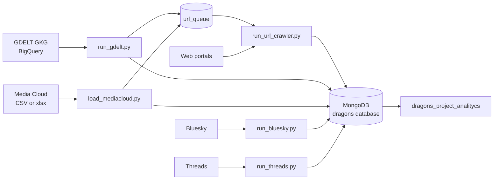

# 🐉 DRAGONS Data ETL

### Data Engineering Component of the DRAGONS Project

- **Project:** DRAGONS – *Diffusing biodiversity Response-able Action and awareness raising through citizen empowerment, inclusive engagement and innovative Governance of Nature and Society*
- **Work Package:** WP1 – Understanding social perceptions, awareness, and participatory responses to biodiversity loss (Task 1.1)
- **Institution:** Pontificia Universidad Javeriana
- **Related repositories:** [`dragons_project_nlp`](https://claude.ai/dragons_project_nlp) (platform: MongoDB, PostgreSQL, Metabase, Airflow, RAG) and [`dragons_project_analitycs`](https://claude.ai/dragons_project_analitycs) (variables, models, and results)

---

## Objective

Collect, transform, validate, and store information from public or authorized sources (news and social media) in MongoDB in a reproducible, traceable, and quality-controlled manner for subsequent use in the analytics repository.

## What This Repository Does

| Pipeline | Script | Output |
|---|---|---|
| GDELT event-based extraction | `scripts/run_gdelt.py` | SQL queries per event, GKG records (`whitelist`), URLs added to the queue, and per-query metrics |
| Media Cloud | `scripts/load_mediacloud.py` | Whitelist entries (`media_cloud_sources`) and URLs added to the queue |
| URL queue crawling | `scripts/run_url_crawler.py` | Text, title, author, date, and language for each URL (`url_crawls`) |
| Bluesky | `scripts/run_bluesky.py` | Posts by country and keywords (`bluesky_posts`) |
| Threads | `scripts/run_threads.py` | Posts and, optionally, replies (`threads_posts`, `threads_replies`) |
| Export | `scripts/export_mongo_sample.py` | CSV/Excel samples from all collections |

All runs produce an auditable summary in `pipeline_runs`, with one of the following statuses: `success`, `partial`, `failed`, or `quota_exceeded`.



The complete diagrams (logical architecture, deployment, processes, sequences, data model, and class diagrams) are available in `docs/diagramas/` and in the project's technical documentation.

---

## Project Team

### Leadership

- **PhD Luis Gabriel Moreno Sandoval** — *Technical & Data Analytics Lead*. Section Head and Professor, Department of Systems Engineering. Provides technical and methodological leadership for the data component. 📧 [morenoluis@javeriana.edu.co](mailto:morenoluis@javeriana.edu.co)
- **PhD Juan David Amaya Espinel** — *Biodiversity Research & Domain Lead*. Associate Professor, Department of Ecology and Territory. Provides scientific and subject-matter leadership for the biodiversity component. 📧 [jamayae@javeriana.edu.co](mailto:jamayae@javeriana.edu.co)

### Coordination

- **Juan Pablo Arias Buitrago** — *Data Scientist & Technical Project Coordinator*. Coordinates technical and operational activities, data requirements, and output validation. 📧 [ariasj.u@javeriana.edu.co](mailto:ariasj.u@javeriana.edu.co)
- **Pabla Lozano Ramírez** — *Biodiversity Domain Lead & Research Project Coordinator*. Oversees sources, search terms, and the thematic relevance of the corpus. 📧 [pabla-lozano@javeriana.edu.co](mailto:pabla-lozano@javeriana.edu.co)

### Data Science and Analytical Validation

- **Sergio Pardo Hurtado** — *NLP Data Scientist & Lead Data Analyst*. Defines the fields, variables, and quality criteria required by the analytics component. 📧 [sergio_pardo@javeriana.edu.co](mailto:sergio_pardo@javeriana.edu.co)

### Data Engineering and Platform

- **Viviana Gómez León** — *Data Engineer & Platform Developer*. Develops connectors and handles data extraction, transformation, and persistence. 📧 [gomezlv@javeriana.edu.co](mailto:gomezlv@javeriana.edu.co)
- **Marlon Jhoan García Restrepo** — *Data Engineer & DevOps Engineer*. Handles pipelines, quality assurance, automation, containers, and infrastructure. 📧 [mjgarcia@javeriana.edu.co](mailto:mjgarcia@javeriana.edu.co)

---

## Requirements

- Python 3.12
- Accessible MongoDB instance. The current target is the MongoDB instance used by the [`dragons_project_nlp`](https://claude.ai/dragons_project_nlp) platform (`localhost:50030` from the host machine, `dragons-mongo:27017` within the shared Docker network).
- GDELT only: a Google Cloud project with BigQuery enabled and a service account. Queries are billed according to the number of bytes processed.
- Bluesky with authentication only: a handle and an *App Password* (never use the account password).
- Threads only: a Meta application and an access token. Without a token, only the offline sample mode is available.

## Installation

```bash
python -m venv .venv
source .venv/bin/activate        # Windows: .venv\Scripts\Activate.ps1
pip install -r requirements.txt
```

The legacy GDELT scraper (`src/gdelt/collectors/web/news_extractor.py`) uses Playwright as a fallback when HTTP 403 errors occur. Playwright is not included in `requirements.txt`; install it only if needed:

```bash
pip install playwright && playwright install chromium
```

## Configuration

Copy `.env.example` to `.env` (never commit it to version control).

| Variable | Purpose |
|---|---|
| `MONGODB_URI` | Connection string. Local: `mongodb://<username>:<password>@localhost:50030/?authSource=admin` |
| `MONGODB_DATABASE` | Database name (defaults to `dragons`) |
| `GOOGLE_APPLICATION_CREDENTIALS` | Path to the BigQuery service account JSON file |
| `BLUESKY_IDENTIFIER`, `BLUESKY_APP_PASSWORD` | Optional Bluesky authentication |
| `THREADS_APP_ID`, `THREADS_APP_SECRET`, `THREADS_ACCESS_TOKEN` | Threads access credentials |

> The credentials in `.env.example` are intended for **local development**. Change them in any other environment.

Configuration files in `config/`:

| File | Contents |
|---|---|
| `settings/mongodb.yaml` | URI, database name, names of the 15 collections, timeouts, and indexes created at startup |
| `settings/pipeline.yaml` | Run prefix, system monitoring interval, and minimum free disk space (512 MB) |
| `sources/gdelt.yaml` | BigQuery table, date range, `max_rows`, `batch_size`, and `max_bytes_billed` |
| `sources/mediacloud.yaml` | Whitelist root directory, default strategy (`whitelist`), limit, and language-specific folders |
| `sources/crawler.yaml` | `user_agent`, timeouts, delay between URLs, `respect_robots_txt`, and maximum HTML size |

## Usage

1. **Start the platform** (MongoDB) from `dragons_project_nlp`: start `docker/network`, then `docker/mongo`.

2. **Verify the connection:**

   ```bash
   python scripts/smoke_local_mongo.py
   ```

3. **GDELT event-based extraction**

   ```bash
   python scripts/seed_events.py
   python scripts/run_gdelt.py --max-events 1 --row-limit 10 --skip-scrape
   python scripts/run_gdelt.py --event-id UK-01 --event-id CO-01 --row-limit 100 --skip-scrape
   ```

   `--skip-scrape` skips the legacy scraper; URLs remain in `url_queue` for the crawler to process.

4. **Media Cloud:**

   ```bash
   python scripts/load_mediacloud.py --limit 10
   ```

5. **Crawl the URL queue:**

   ```bash
   python scripts/run_url_crawler.py --source media_cloud --limit 10
   ```

   Use `--watch --poll-seconds 30` to run the process continuously.

6. **Social media**

   ```bash
   python scripts/run_bluesky.py --countries colombia --limit 10
   python scripts/run_threads.py --countries colombia --limit 10 --download-replies
   ```

7. **Export samples:**

   ```bash
   python scripts/export_mongo_sample.py --limit 10 --format both
   ```

8. **End-to-end test with 10 documents and no BigQuery dependency:**

   ```bash
   python scripts/run_url_poc_10.py
   ```

## Data Model (`dragons` database)

| Collection | Contents | Unique Key |
|---|---|---|
| `eventos` | Event catalog containing periods, countries, and keywords in EN, ES, and HU | `id` |
| `queries` | SQL queries and parameters submitted to BigQuery for each event | `id` |
| `whitelist` | Normalized GKG records (up to 100 per query) | `id`, `hash` |
| `scrapper` | Output from the legacy scraper | `id`, `hash_whitelist` |
| `metrics` | Per-query metrics (BigQuery, processing, MongoDB, and system) | `id`, `id_query` |
| `media_cloud_sources` | Media Cloud whitelist entries | `source_uid` |
| `url_queue` | Shared URL queue (GDELT and Media Cloud) | `url_hash + source + strategy` |
| `url_crawls` | Download attempts and extracted text | `queue_id` |
| `bluesky_posts` | Bluesky posts (original `texto_raw` and cleaned `text`) | `uri` |
| `threads_posts`, `threads_replies` | Threads posts and replies | `id` |
| `pipeline_runs` | Auditable summary for each run | `run_id` |
| `gkg_records`, `crawled_data`, `execution_metrics` | Previous batch-based design (legacy) | `gkg_record_id`, `run_id` |

Crawl statuses in `url_crawls`: `success`, `empty`, `http_error`, `invalid_url`, `robots_disallowed`.

Queue statuses: `pending`, `queued`, `retry`, `processing`, `crawled`, `crawl_failed`.

## Repository Structure

```text
config/            YAML configuration (settings and sources)
docs/              Methodology, document model, events, and diagrams
experiments/       Source discovery and Media Cloud exploration (non-production)
news_client/       Ad hoc GDELT queries in BigQuery
queries/gdelt/     Version-controlled SQL (extraction, analysis, and metadata)
scripts/           Operational scripts
src/
  gdelt/           Collectors, pipelines, processing, quality, monitoring, and database
  mediacloud/      Whitelist loader, keyword maps, query_mongo.py
  bluesky/         Client, document conversion, and pipeline
  threads/         Client, document conversion, and pipeline
  social_keywords.py   Country-specific social media queries based on keyword maps
tests/             Unit tests (pytest, mongomock)
```

## Tests

```bash
pytest
```

## Quality and Traceability

- Document-level validation (structure, identifier, date, source, URL, and content) and deduplication using identifiers and unique indexes.
- Unordered inserts and idempotent upserts: a failed record does not abort the batch.
- Cost limits (`max_bytes_billed`, with a preliminary *dry run*) and disk-space limits (`min_free_disk_bytes`).
- Per-query metrics and run summaries (`metrics`, `pipeline_runs`).
- Each record retains its `run_id`, origin (`source_file`, `source_row` in Media Cloud), and original text (`texto_raw`) alongside the cleaned text.

## Responsible Use and Compliance

- The crawler respects `robots.txt`, identifies itself using a custom `User-Agent`, limits response size to 5 MB, and waits between requests.
- The terms of use of GDELT, Media Cloud, Bluesky, and Threads, as well as the copyright of article text, are **not** covered by the code license. Do not redistribute the textual corpus; share identifiers, URLs, and derived indicators instead.
- Social media posts contain personal data (identifiers and usernames). Minimize or pseudonymize such data when it is not necessary, and consult the data protection officer.

## Known Limitations

- `docker-compose.yml` and `Dockerfile` execute legacy commands (`query_mongo.py`, `loader.py`, and `news_extractor.py` in the repository root), and the `Dockerfile` installs Playwright even though it is not listed in `requirements.txt`.
- The catalog `data/events/DRAGONS_T1.csv` (68 events) is not version-controlled; it must be copied to that path before running `seed_events.py`.
- The process that consolidates the collections into `analytics_text_documents.parquet`, which is consumed by the analytics component, has not yet been implemented.
- The shared queue and `ArticleCrawler` (without browser fallback) coexist with the legacy Playwright-based scraper, along with collections from the previous design.
- `src/mediacloud/query_mongo.py` queries the `news` collection by default, which is no longer written to by this pipeline.
- The `config/sources/newspapers.yaml` and `social_media.yaml` files are empty.

## Documentation

[`docs/Metodologia_task1.1.md`](https://claude.ai/chat/docs/Metodologia_task1.1.md) · [`docs/diagrama_de_documentos.md`](https://claude.ai/chat/docs/diagrama_de_documentos.md) · [`docs/eventos.md`](https://claude.ai/chat/docs/eventos.md) · [`docs/national_media_candidates.md`](https://claude.ai/chat/docs/national_media_candidates.md) · [`docs/InformeSemana4.md`](https://claude.ai/chat/docs/InformeSemana4.md) · [`news_client/README.md`](https://claude.ai/chat/news_client/README.md)

## License

This code is distributed under the **Apache License 2.0** (see [`LICENSE`](https://claude.ai/chat/LICENSE) and [`NOTICE`](https://claude.ai/chat/NOTICE)). Third-party dependencies are listed in [`THIRD_PARTY_LICENSES.md`](https://claude.ai/chat/THIRD_PARTY_LICENSES.md).

The license applies only to the code in this repository. Collected data remains subject to the access conditions, licenses, and terms of use of each source.

## Funding

This work has received funding from the European Union's Horizon Europe Research and Innovation Programme under Grant Agreement No. 101291624. The views and opinions expressed are those of the authors and do not necessarily reflect those of the European Union or the granting authority.

## Contact

**PhD Luis Gabriel Moreno Sandoval** — Pontificia Universidad Javeriana — 📧 [morenoluis@javeriana.edu.co](mailto:morenoluis@javeriana.edu.co)
